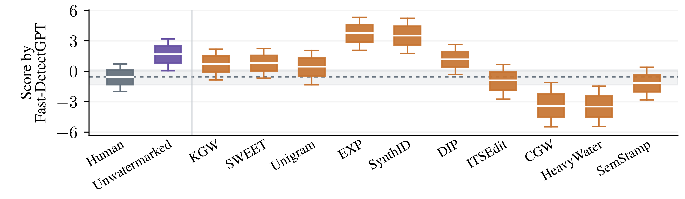
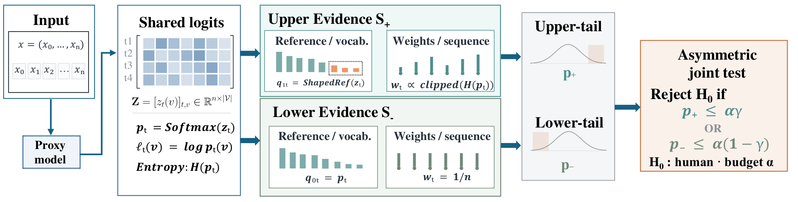

# Resolving Score-Ordering Reversal in Watermarked Text

Code, benchmark texts, and experimental results for **“Resolving Score-Ordering
Reversal in Watermarked Text: An Asymmetric Two-Sided Test for LLM Text
Detection”**. The paper is under review; author information is anonymized.

[Paper](paper/paper.pdf) |
[Installation](#installation) |
[Reproducing reported artifacts](#reproducing-reported-artifacts) |
[Detailed reproduction guide](docs/REPRODUCE.md) |
[Citation](#citation)

## Overview

Watermarking can reverse the ordering of machine and human detection scores.



**Figure 1.** Fast-DetectGPT score distributions with the native OPT proxy.
Several watermarking conditions shift scores below human text, motivating
detection in both tails. [View the paper's vector figure](analysis/figures/score_distributions.pdf).

The main evaluation covers 660 settings, with 800 calibration humans,
2,360 test humans, and 129,800 machine texts. The reported mean AUROCs are:

| Detector proxy | Mean AUROC |
| --- | --- |
| OPT-2.7B | 0.8219 |
| Falcon-7B / Falcon-7B-Instruct | 0.8317 |

## Method

Our detector combines an entropy-weighted, shaped-reference upper statistic
with an original-reference, uniformly weighted lower statistic. Human
calibration scores turn these into an asymmetric two-sided test.



**Figure 2.** Shared model outputs provide upper- and lower-tail evidence,
which is calibrated against human scores and combined in an asymmetric joint
test. [View the paper's vector diagram](analysis/figures/overview.pdf).

## Installation

Use **Python 3.10 or 3.11**. The CPU workflow is verified with Python 3.11.
Clone the repository and install the analysis dependencies:

```bash
git clone https://github.com/wlzzzzzzz/score-reversal-two-sided-detector.git
cd score-reversal-two-sided-detector
python3 -m venv .venv
. .venv/bin/activate
python3 -m pip install -r requirements-analysis.txt
```

The checkout is approximately **2.1 GiB** because it includes benchmark texts
and document-level score caches. The analysis workflow below needs no GPU,
model download, LaTeX, or external source corpus.

For fresh language-model scoring, install `requirements-gpu.txt` and obtain
the OPT/Falcon checkpoints described in
[the GPU setup instructions](docs/REPRODUCE.md#3-prepare-for-fresh-model-scoring-of-all-80-benchmark-cells).
Watermark generation additionally uses `requirements-generation.txt` and
the [generation dependencies](docs/REPRODUCE.md#optional-generation-and-baseline-dependencies).
Model checkpoints and optional external inputs are downloaded separately.

## Reproducing reported artifacts

Run all commands from the repository root with the environment activated.
The following steps rebuild the final detector from the included document
moments and compare its outputs with the reported results. Fresh model
scoring is documented separately below. Detailed table and figure workflows
are available in the [full reproduction guide](docs/REPRODUCE.md).

### 1. Verify the included files

```bash
python3 scripts/check_release.py
python3 scripts/check_paths.py
```

These checks verify file hashes, all 80 benchmark cells, portable paths,
the main result values, and the inventory for 19 paper tables and two figures.

### 2. Recompute the final detector results

```bash
python3 scripts/evaluate_detector.py --output scratch/detector --check-paper
```

This rebuilds human calibration, both directional p-values, and final scores
from the saved document moments. It checks all **1,320 task rows** across the
two proxy settings, aggregate metrics, and deployment metrics against the
reported results at absolute tolerance `1e-12`.

| Proxy | Expected mean AUROC |
| --- | --- |
| OPT | 0.8219095663414562 |
| Falcon | 0.8316661796123974 |

Results are written to `scratch/detector/`, including `summary.csv`,
`task_metrics.csv`, `deployment.csv`, and `audit.json`. The directory is
created automatically. Choose a new output name when repeating the run.

### 3. Run fresh model scoring

Follow [the staged GPU workflow](docs/REPRODUCE.md#3-prepare-for-fresh-model-scoring-of-all-80-benchmark-cells)
to score all 80 included benchmark cells, freeze the development analysis,
and recompute test calibration and final detection metrics. Fresh numerical
results can vary with hardware, CUDA, and checkpoint revisions.

Recreating the benchmark from upstream corpora and rerunning every historical
baseline require additional inputs. Their availability and setup are listed
under [historical rerun limits](docs/REPRODUCE.md#limits-of-a-full-historical-rerun).

## Repository structure

| Directory | Contents |
| --- | --- |
| `scripts/` | Detector evaluation, model scoring, generation, baseline implementations, and release checks |
| `experiments/` | Matched two-sided controls and HeavyWater generation controls |
| `configs/` | Benchmark roster and frozen experiment configurations |
| `data/` | The 80 benchmark text cells and source attribution |
| `results/` | Baseline caches, document-level scores, experimental results, and scientific audits |
| `analysis/` | Numerical exports, table/figure reproduction code, and published tables and figures |
| `third_party/` | Watermark implementations required by the paper experiments and their original licenses |
| `tests/` | Regression tests for the detector, scoring workflow, and release checks |
| `docs/` | Reproduction instructions, paper-result mapping, protocols, and provenance |
| `paper/` | The complete manuscript PDF in preprint format |

`manifest.json` records the relative path, size, and SHA-256 of every
published artifact. Runtime directories such as `scratch/` and `models/`
are created locally and ignored by Git. See [path conventions](docs/PATHS.md).

## Citation

The provisional citation is in [CITATION.bib](CITATION.bib). Authors are
currently anonymized; an arXiv identifier will be added when available.

## Acknowledgments and license

This repository builds on [Fast-DetectGPT](https://github.com/baoguangsheng/fast-detect-gpt)
and the watermark implementations listed in [third-party components](third_party/README.md).
Original project code and accompanying software documentation use the
[MIT License](LICENSE). Third-party components retain their own licenses.
Source datasets, model checkpoints, and the manuscript are outside the scope
of this code license. See [data sources and terms](data/README.md) and
[provenance](docs/PROVENANCE.md) for attribution and redistribution status.
